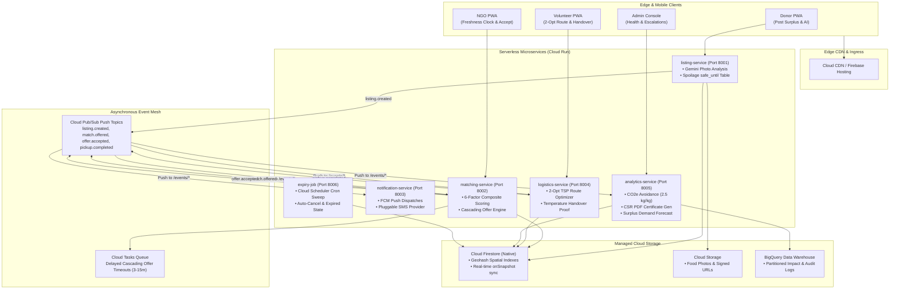

# FoodBridge: Real-Time Food Surplus Redistribution Network

[](https://github.com/foodbridge/foodbridge/actions/workflows/ci.yml)
[](https://opensource.org/licenses/MIT)
[](https://cloud.google.com)
[](https://python.org)
[](https://fastapi.tiangolo.com)
[](https://react.dev)

FoodBridge is an event-driven, cloud-native platform connecting hotels, caterers, banquet halls, and wedding venues with nearby NGOs, shelters, and volunteer couriers to redistribute edible surplus food **before it spoils**.

Designed as a premier cloud computing showcase, the system demonstrates serverless microservices on **Google Cloud Run**, an asynchronous event mesh on **Cloud Pub/Sub**, delayed point-in-time escalations via **Cloud Tasks**, multimodal AI via **Google Gemini 1.5 Flash**, spatial indexing in **Firestore**, real-time PWA synchronization, and automated Infrastructure as Code via **Terraform**.

---

## 1. Cloud-Native Architecture



---

## 2. Signature Features

1. **Spoilage-Aware Matching & Hard Filter**:
   Calculates `safe_until` from food category, preparation timestamp, and storage condition (ambient, refrigerated, hot-hold). Candidates are disqualified if $(\text{Transit ETA} + \text{Handover Buffer}) > (\text{Safe Until} - 30\text{ min Safety Margin})$.
2. **Explainable 6-Factor Composite Score**:
   $$\text{Score} = 0.30 \cdot F_{\text{time}} + 0.25 \cdot F_{\text{prox}} + 0.15 \cdot F_{\text{cap}} + 0.10 \cdot F_{\text{diet}} + 0.15 \cdot F_{\text{rel}} + 0.05 \cdot F_{\text{urg}}$$
   Every match returns the per-factor breakdown for auditability.
3. **Cascading Offer Escalation**:
   Sequential offer to Rank 1 with dynamic timeout $\tau = \text{clamp}(0.10 \times \text{remaining shelf life}, 3\text{ min}, 15\text{ min})$. Auto-escalates to next rank via Cloud Tasks upon timeout or decline; broadens radius to 30 km if local candidates are exhausted.
4. **Multimodal AI Food Inspection**:
   Analyzes surplus food images via Gemini 1.5 Flash for category classification, portion estimation, and safety flags. Gracefully falls back to deterministic rule tables if offline or without API keys.
5. **2-Opt Volunteer Route Optimizer**:
   Nearest-Neighbour + 2-Opt TSP route planner with strict pickup deadline constraints, generating turn-by-turn stops and ETAs.
6. **Trust & Food Safety Layer**:
   Cold-chain temperature verification ($>60^\circ\text{C}$ hot-hold / $<5^\circ\text{C}$ cold), photo verification, and post-pickup reliability ratings.
7. **Environmental Impact & CSR Certificates**:
   Tracks meals saved, kg diverted, and $\text{CO}_2\text{e}$ avoided ($2.5\text{ kg CO}_2\text{e}$ per kg food). Automatically generates downloadable monthly corporate CSR certificates as cryptographic PDFs.
8. **Predictive Surplus Forecasting**:
   Projects expected surplus per donor/weekday/hour using seasonal baseline moving average + linear trend regression with commercial diurnal multipliers.
9. **Interactive PWA with Live Map & i18n**:
   Offline-first installable React PWA with Leaflet OpenStreetMap, live Freshness Clocks, and full localization in **English, Hindi, and Kannada**.
10. **Zero-Cloud-Credentials Local Simulation**:
    Runs out-of-the-box locally via an in-memory event bus adapter and includes pre-scripted scenarios (`wedding_rush`, `lunch_rush`, `ngo_unresponsive`) and a Locust load test.

---

## 3. Quickstart: Local Mode (Zero Cloud Credentials)

FoodBridge runs locally without any cloud account, Docker requirements, or GCP credentials.

### Prerequisites:
- Python 3.11+
- Node.js 18+ & npm

### Step 1: Install Dependencies & Setup Environment
```bash
# Clone the repository
git clone https://github.com/foodbridge/foodbridge.git
cd foodbridge

# Copy local development configuration
cp .env.example .env

# Install shared library in editable mode
pip install -e services/shared
pip install -r services/listing-service/requirements.txt \
            -r services/matching-service/requirements.txt \
            -r services/notification-service/requirements.txt \
            -r services/logistics-service/requirements.txt \
            -r services/analytics-service/requirements.txt \
            -r services/expiry-job/requirements.txt

# Install web dependencies
cd web && npm install && cd ..
```

### Step 2: Start the Local Microservices Mesh
In Terminal 1:
```bash
python scripts/dev_servers.py
```
This boots the unified in-memory event mesh and starts:
- `listing-service` on `http://localhost:8001`
- `matching-service` on `http://localhost:8002`
- `logistics-service` on `http://localhost:8004`
- `analytics-service` on `http://localhost:8005`

### Step 3: Start the Frontend Web Application
In Terminal 2:
```bash
cd web
npm run dev
```
Open **`http://localhost:5173`** in your browser.

---

## 4. Running the Real-Time Simulator

To demonstrate real-time matching, cascading offers, and impact counters under heavy traffic, run the pre-built scenarios with a speed multiplier:

```bash
# Simulate a 10x accelerated wedding banquet rush
python simulator/simulate.py --scenario simulator/scenarios/wedding_rush.json --speed 10

# Simulate lunch hour surplus
python simulator/simulate.py --scenario simulator/scenarios/lunch_rush.json --speed 5

# Simulate unresponsive NGOs triggering cascading timeouts and escalations
python simulator/simulate.py --scenario simulator/scenarios/ngo_unresponsive.json --speed 10
```

Watch the live counters update in real time on the **Live Map** (`/live-map`) and **Impact Dashboard** (`/impact`).

---

## 5. Running the Test Suite & Verification

Run all unit tests, mathematical scoring tests, 2-Opt optimizer tests, and end-to-end integration tests:

```bash
# Run complete test runner
python scripts/test_runner.py

# Or run via Makefile
make test
```

Run the Locust concurrent load test:
```bash
cd simulator/load_test
locust -f locustfile.py --headless -u 50 -r 10 --run-time 30s --host http://localhost:8001
```

---

## 6. Google Cloud Platform Deployment (Free-Tier Friendly)

### Step 1: Bootstrap GCP Project
```bash
./scripts/setup_gcp.sh YOUR_GCP_PROJECT_ID asia-south1
```

### Step 2: Configure Terraform
```bash
cd infra/terraform
cp terraform.tfvars.example terraform.tfvars
# Edit terraform.tfvars with your GCP project ID
terraform init
terraform apply
```

### Step 3: Build & Deploy Microservices to Cloud Run
```bash
./scripts/deploy.sh YOUR_GCP_PROJECT_ID asia-south1 v1.0.0
```

---

## 7. User Interface Showcase & Screenshots

The FoodBridge PWA features a dark-mode glassmorphic interface designed for high clarity in noisy kitchen and transit environments:

- **Donor Dashboard & Post Surplus**: Real-time listing status with multimodal Gemini AI suggestions.
- **NGO Live Feed**: Cascading offer cards with color-coded **Freshness Clocks** and explainable composite match factor bars.
- **Volunteer Courier Route**: Ordered 2-Opt stops with pickup deadlines, ETAs, and temperature handover checkpoints.
- **Live Spatial Map**: Network-wide Leaflet OpenStreetMap showing real-time food redistribution across the city.
- **Impact & CSR Dashboard**: Animated counters (meals saved, kg diverted, $\text{CO}_2\text{e}$ avoided) and 1-click CSR PDF certificate download.
- **Admin Console**: Multi-tier donor verification queue, unresolved escalation monitors, and microservice health statuses.

---

## 8. Detailed Technical Documentation

- [Architecture & Sequence Diagrams](docs/architecture.md)
- [Spoilage-Aware Matching Algorithm](docs/matching-algorithm.md)
- [Complete REST API Reference](docs/api.md)
- [Security, IAM & Anti-Fraud Model](docs/security.md)
- [Cost Modeling & Scaling Strategy](docs/cost-and-scaling.md)
- [5-Minute Examiner Demo Script](docs/demo-script.md)
- [Examiner Technical Q&A (20 Questions)](docs/examiner-qna.md)

---

## 9. License & Credits

Developed with modern cloud-native principles for sustainable cities and zero food waste. Released under the [MIT License](LICENSE).
