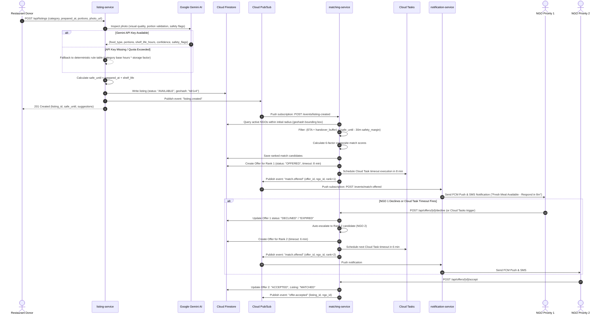
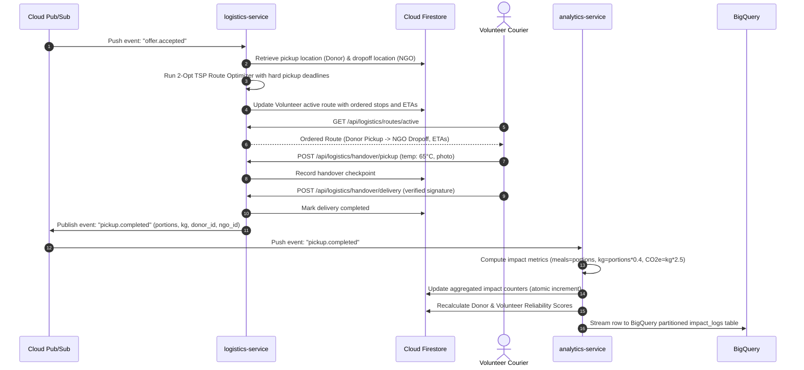

# FoodBridge: Cloud-Native System Architecture

## 1. Executive Summary & Philosophy
FoodBridge is an event-driven, serverless platform designed to solve the critical problem of urban food surplus redistribution before cooked or perishable items spoil. Because cooked food degrades rapidly (often having a safe window of 2 to 6 hours), every component in FoodBridge prioritizes **zero-latency dispatch**, **eventual consistency with guaranteed delivery**, **explainable matching**, and **graceful fallback**.

The platform is designed around **Google Cloud Platform (GCP)** managed serverless primitives, ensuring high availability, zero idle costs (free-tier friendly), and automated horizontal scalability up to tens of thousands of concurrent requests.

---

## 2. High-Level Component Topology

```mermaid
flowchart TB
    subgraph Clients["Edge & Clients"]
        DonorApp["Donor PWA (Mobile/Web)"]
        NgoApp["NGO PWA (Mobile/Web)"]
        VolApp["Volunteer PWA (Mobile/Web)"]
        AdminApp["Admin Dashboard"]
    end

    subgraph CDN["Edge Ingress & Static Delivery"]
        FBHosting["Firebase Hosting / Cloud CDN"]
    end

    subgraph Gateways["API Ingress & Identity"]
        GCPAuth["Firebase Auth (Custom Claims: donor, ngo, volunteer, admin)"]
        CloudRunIngress["Cloud Run HTTPS Microservices"]
    end

    subgraph Microservices["Serverless Microservices (Cloud Run)"]
        ListingSvc["listing-service (Port 8001)<br/>• Photo Gemini AI<br/>• Spoilage safe_until computation"]
        MatchingSvc["matching-service (Port 8002)<br/>• 6-Factor Composite Scoring<br/>• Cascading Offer Engine"]
        NotifSvc["notification-service (Port 8003)<br/>• FCM Push Dispatches<br/>• Pluggable SMS Gateway"]
        LogisticsSvc["logistics-service (Port 8004)<br/>• 2-Opt Multi-Stop Routing<br/>• Handover Checkpoints"]
        AnalyticsSvc["analytics-service (Port 8005)<br/>• CO2e Impact Aggregator<br/>• CSR PDF Generation<br/>• Surplus Forecasting"]
        ExpiryJob["expiry-job (Port 8006)<br/>• Cloud Scheduler Cron Scanner<br/>• Timeout & Expired State Machine"]
    end

    subgraph EventMesh["Asynchronous Event Mesh"]
        PubSub["Cloud Pub/Sub Topics<br/>listing.created, match.offered, offer.accepted, etc."]
        CloudTasks["Cloud Tasks Queue<br/>Delayed Cascading Offer Timeouts"]
        DeadLetter["Dead Letter Topics & Alerting"]
    end

    subgraph DataStorage["Managed Cloud Persistence"]
        Firestore["Cloud Firestore (Native Mode)<br/>• Geohash Spatial Indexing<br/>• Real-time onSnapshot Synchronization"]
        GCS["Cloud Storage<br/>• Food Item Photos & CSR Certificates"]
        BigQuery["BigQuery Data Warehouse<br/>• Partitioned Impact & Audit Logs"]
    end

    %% Client Interactions
    DonorApp --> FBHosting
    NgoApp --> FBHosting
    VolApp --> FBHosting
    AdminApp --> FBHosting

    DonorApp --> GCPAuth
    DonorApp --> ListingSvc
    NgoApp --> MatchingSvc
    VolApp --> LogisticsSvc
    AdminApp --> AnalyticsSvc

    %% Service to Storage
    ListingSvc --> Firestore
    ListingSvc --> GCS
    MatchingSvc --> Firestore
    LogisticsSvc --> Firestore
    AnalyticsSvc --> Firestore
    AnalyticsSvc --> BigQuery
    ExpiryJob --> Firestore

    %% Event Connections
    ListingSvc -- "listing.created" --> PubSub
    PubSub -- "Push to /events/*" --> MatchingSvc
    MatchingSvc -- "match.offered" --> PubSub
    PubSub -- "Push to /events/*" --> NotifSvc
    MatchingSvc -- "Schedule Timeout (3-15m)" --> CloudTasks
    CloudTasks -- "Dispatch Timeout Callback" --> MatchingSvc
    MatchingSvc -- "offer.accepted" --> PubSub
    PubSub -- "Push to /events/*" --> LogisticsSvc
    LogisticsSvc -- "pickup.completed" --> PubSub
    PubSub -- "Push to /events/*" --> AnalyticsSvc
```

---

## 3. End-to-End Event Flow & Sequence Diagrams

### 3.1. Food Donation Ingestion, AI Safety Inspection & Cascading Match

The following sequence diagram details the full cycle: from a donor posting food, through Gemini multimodal safety analysis, composite scoring, and the cascading offer lifecycle.

---

### 3.2. Volunteer Logistics, Route Batching & Impact Finalization

---

## 4. Architectural Justifications for Managed Cloud Primitives

| Component | Choice | Alternative Considered | Technical Justification |
| :--- | :--- | :--- | :--- |
| **Microservice Runtime** | **Google Cloud Run (v2)** | GKE (Kubernetes), Compute Engine VM | Microservices scale automatically from 0 to hundreds of instances based on HTTP/PubSub traffic. Billed per 100ms of CPU execution time, meaning $0 idle cost during off-peak hours (e.g. 2 AM–6 AM). Container packaging guarantees identical execution between local Docker and production. |
| **Asynchronous Bus** | **Cloud Pub/Sub (Push)** | Kafka, RabbitMQ | Fully managed, zero-ops event streaming with 99.95% SLA. Push subscriptions convert event fanouts into standard HTTPS calls directly into Cloud Run endpoints, eliminating the need to run persistent consumer listener daemon pools. |
| **Delayed Escalation** | **Google Cloud Tasks** | Celery + Redis, Quartz | Offer response timeouts (3 to 15 minutes) require delayed point-in-time invocation. Running Celery requires a dedicated Redis cluster. Cloud Tasks provides serverless, rate-limited, deduped HTTP dispatch at a specific timestamp with automatic retries. |
| **Operational Database**| **Cloud Firestore (Native)**| Cloud SQL (PostgreSQL), MongoDB Atlas | Sub-millisecond reads, native geospatial support, and client SDK `onSnapshot()` listeners enable live real-time UI updates (e.g. fresh food disappearing the second another NGO claims it) without WebSockets or polling servers. |
| **Analytical Warehouse**| **Google BigQuery** | PostgreSQL read replica | Massive streaming insert capability for audit and telemetry logs. Serverless SQL engine allows instant forecasting aggregations across years of donation trends without impacting operational OLTP transactions. |
| **Scheduled Jobs** | **Google Cloud Scheduler** | Cron on VM, Celery Beat | Cloud Scheduler triggers the `expiry-job` endpoint over HTTPS with OIDC service account authentication every 5 minutes to sweep expired listings. |
| **AI Perception** | **Google Gemini 1.5 Flash** | Custom YOLO on GPU | Ultra-fast multimodal model capable of identifying food freshness, portion sizing, packaging integrity, and contamination flags in < 1 second. Fallback table ensures zero availability impact if network is partitioned. |

---

## 5. Fault Tolerance, Idempotency & Dead Letter Strategy

1. **Idempotency Guarantees**:
   Every message published to Cloud Pub/Sub contains a unique `event_id`. Microservice endpoints track processed `event_id` keys in Firestore with a 7-day TTL. Duplicate events (a known property of at-least-once message brokers) are acknowledged immediately without re-triggering business logic.
2. **Dead-Letter Topics (DLQ)**:
   Every Cloud Pub/Sub subscription defines a `dead_letter_policy` routed to `foodbridge-dead-letter`. If an endpoint returns HTTP 5xx or times out 5 consecutive times with exponential backoff, the message is sequestered for human inspection, and a Cloud Monitoring alert is dispatched.
3. **Graceful AI Degradation**:
   When the Gemini API is unreachable, times out, or when running in local development mode without GCP credentials, `vision.py` automatically activates the deterministic rule engine. The engine computes food category heuristics, portions, and shelf life based on safe temperature baselines.
