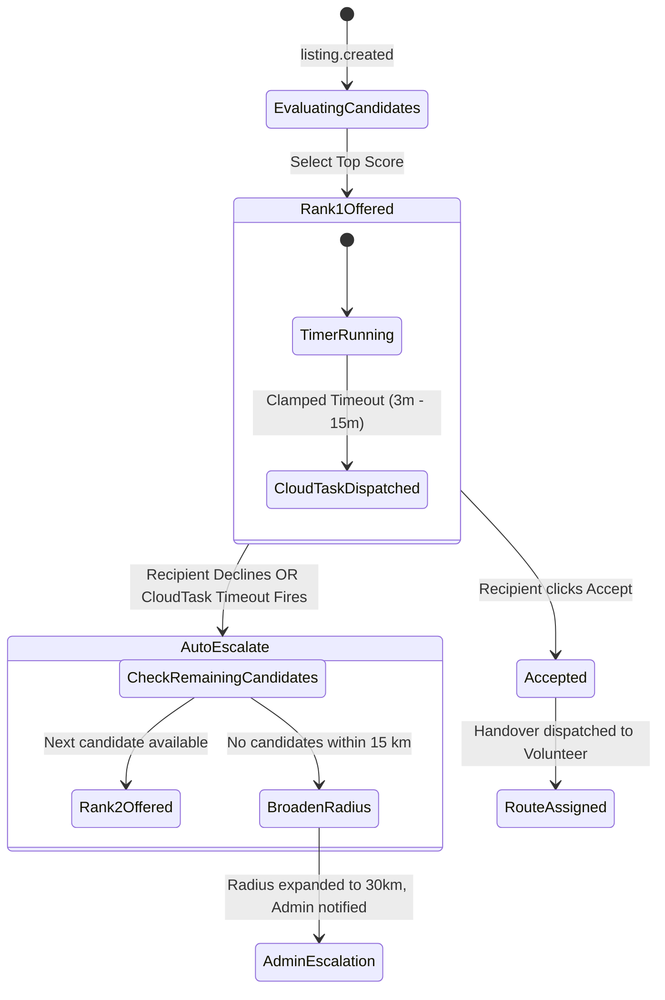

# FoodBridge: Spoilage-Aware Composite Matching Algorithm

## 1. Overview & Objective
In urban food surplus distribution, traditional proximity-only or FIFO matching algorithms fail because food is a decaying asset. A high-capacity shelter located 12 km away might be a better match in theory, but if traffic causes the transit time to exceed the food's safe shelf-life window, the food becomes biohazardous waste.

FoodBridge implements a **two-stage matching pipeline**:
1. **Stage 1 (Hard Spoilage Filter)**: Eliminates candidates who cannot physically receive and store the food before safe consumption thresholds elapse.
2. **Stage 2 (6-Factor Composite Scoring & Explainability)**: Ranks eligible candidates using a multi-criteria decision model.

---

## 2. Mathematical Formulation

### 2.1. Hard Spoilage Feasibility Condition

Let $T_{\text{current}}$ be the current UTC timestamp, $T_{\text{safe}}$ be the calculated expiration threshold (`safe_until`), $\tau_{\text{ETA}}$ be the estimated transit time, $\tau_{\text{handover}}$ be the buffer time required for physical loading/inspection (default 15 minutes), and $\tau_{\text{margin}}$ be the mandatory food safety reserve margin (default 30 minutes).

A candidate recipient (NGO or shelter) is mathematically eligible **if and only if**:

$$(T_{\text{current}} + \tau_{\text{ETA}} + \tau_{\text{handover}}) \le (T_{\text{safe}} - \tau_{\text{margin}})$$

Or equivalently:
$$\tau_{\text{remaining\_shelf\_life}} - (\tau_{\text{ETA}} + \tau_{\text{handover}}) \ge \tau_{\text{margin}}$$

If this condition evaluates to **False**, the candidate is strictly disqualified with score $0.0$, regardless of proximity or capacity.

---

### 2.2. Composite Scoring Equation

For all candidates passing Stage 1, the match score $S \in [0.0, 1.0]$ is computed as:

$$S = 0.30 \cdot F_{\text{time}} + 0.25 \cdot F_{\text{prox}} + 0.15 \cdot F_{\text{cap}} + 0.10 \cdot F_{\text{diet}} + 0.15 \cdot F_{\text{rel}} + 0.05 \cdot F_{\text{urg}}$$

#### Factor Definitions:

1. **Time Feasibility Factor ($F_{\text{time}}$, weight $0.30$):**
   Measures the safety margin cushion relative to total available shelf-life:
   $$F_{\text{time}} = \min\left(1.0, \max\left(0.0, \frac{\tau_{\text{remaining}} - (\tau_{\text{ETA}} + \tau_{\text{handover}})}{\tau_{\text{remaining}}}\right)\right)$$

2. **Proximity Factor ($F_{\text{prox}}$, weight $0.25$):**
   Non-linear distance decay over a maximum search radius $R_{\max} = 15 \text{ km}$:
   $$F_{\text{prox}} = \max\left(0.0, 1.0 - \frac{d}{R_{\max}}\right)$$
   where $d$ is the Haversine distance in kilometers between donor and NGO coordinates.

3. **Capacity Fit Factor ($F_{\text{cap}}$, weight $0.15$):**
   Ratio of donation quantity $Q_{\text{food}}$ (portions) to recipient capacity $C_{\text{NGO}}$:
   $$F_{\text{cap}} = \begin{cases} 
   1.0 & \text{if } Q_{\text{food}} \le C_{\text{NGO}} \\
   \frac{C_{\text{NGO}}}{Q_{\text{food}}} & \text{if } Q_{\text{food}} > C_{\text{NGO}}
   \end{cases}$$

4. **Dietary Compatibility Factor ($F_{\text{diet}}$, weight $0.10$):**
   Categorical match between food dietary flags and NGO accepted preferences:
   $$F_{\text{diet}} = \begin{cases} 
   1.0 & \text{if } \text{preferences match strictly (e.g. Pure Veg, Halal)} \\
   0.2 & \text{if dietary restriction violated}
   \end{cases}$$

5. **Historical Reliability Factor ($F_{\text{rel}}$, weight $0.15$):**
   Exponential moving average of the NGO's historical pickup completion rate, punctuality, and donor ratings:
   $$F_{\text{rel}} \in [0.0, 1.0], \quad \text{default for new NGOs } = 0.85$$

6. **Need Urgency Factor ($F_{\text{urg}}$, weight $0.05$):**
   Self-reported daily urgency level or time since last meal distribution:
   $$F_{\text{urg}} \in [0.1, 1.0]$$

---

## 3. Algorithm Pseudocode

```python
def rank_candidates(listing: FoodListing, candidates: List[RecipientNGO]) -> List[MatchResult]:
    current_time = datetime.now(timezone.utc)
    remaining_shelf_life_min = (listing.safe_until - current_time).total_seconds() / 60.0
    
    scored_matches = []
    
    for ngo in candidates:
        # Distance & ETA estimation
        dist_km = haversine_distance(listing.latitude, listing.longitude, ngo.latitude, ngo.longitude)
        eta_min = estimate_transit_time_minutes(dist_km)
        handover_buffer_min = 15.0
        safety_margin_min = 30.0
        
        # STAGE 1: Hard Spoilage Filter
        if (eta_min + handover_buffer_min) > (remaining_shelf_life_min - safety_margin_min):
            continue  # Disqualified due to impending spoilage risk
            
        # STAGE 2: Factor Normalization
        f_time = max(0.0, min(1.0, (remaining_shelf_life_min - (eta_min + handover_buffer_min)) / max(remaining_shelf_life_min, 1.0)))
        f_prox = max(0.0, 1.0 - (dist_km / 15.0))
        f_cap = 1.0 if ngo.capacity_portions >= listing.portions else (ngo.capacity_portions / listing.portions)
        f_diet = 1.0 if is_dietary_compatible(listing.dietary_type, ngo.accepted_diets) else 0.2
        f_rel = ngo.reliability_score
        f_urg = ngo.need_urgency
        
        # Composite Weighting
        score = (
            0.30 * f_time +
            0.25 * f_prox +
            0.15 * f_cap +
            0.10 * f_diet +
            0.15 * f_rel +
            0.05 * f_urg
        )
        
        scored_matches.append(MatchResult(
            ngo_id=ngo.id,
            score=round(score, 4),
            breakdown={
                "time_feasibility": round(f_time, 3),
                "proximity": round(f_prox, 3),
                "capacity_fit": round(f_cap, 3),
                "dietary_match": round(f_diet, 3),
                "reliability": round(f_rel, 3),
                "need_urgency": round(f_urg, 3)
            }
        ))
        
    # Sort descending by composite score
    return sorted(scored_matches, key=lambda m: m.score, reverse=True)
```

---

## 4. Worked Numerical Example

Consider a surplus donation from **The Grand Palace Hotel, Bangalore**:
- **Food**: Cooked Biryani & Curry (Cooked Meals category)
- **Portions**: 120 portions
- **Dietary**: Halal Non-Veg
- **Remaining Shelf Life**: 180 minutes (3 hours)
- **Parameters**: Handover Buffer = 15 min, Safety Reserve = 30 min. Max permissible transit time = $180 - 15 - 30 = 135\text{ min}$.

### Candidates Evaluation:

| Parameter | Candidate A: Asha Shelter | Candidate B: Karuna Kitchen | Candidate C: Sneha Home |
| :--- | :--- | :--- | :--- |
| **Distance ($d$)** | 3.5 km | 8.0 km | 14.5 km |
| **Transit ETA** | 18 min | 42 min | 75 min |
| **Total Feasibility Time** | $18 + 15 = 33\text{ min} \le 135\text{ min}$ | $42 + 15 = 57\text{ min} \le 135\text{ min}$ | $75 + 15 = 90\text{ min} \le 135\text{ min}$ |
| **Stage 1 Filter** | **PASS** | **PASS** | **PASS** |
| $F_{\text{time}}$ | $(180 - 33)/180 = 0.817$ | $(180 - 57)/180 = 0.683$ | $(180 - 90)/180 = 0.500$ |
| $F_{\text{prox}}$ | $1 - (3.5/15) = 0.767$ | $1 - (8.0/15) = 0.467$ | $1 - (14.5/15) = 0.033$ |
| $F_{\text{cap}}$ (Capacity) | 150 portions $\rightarrow 1.000$ | 80 portions $\rightarrow 80/120 = 0.667$ | 200 portions $\rightarrow 1.000$ |
| $F_{\text{diet}}$ (Dietary) | Compatible $\rightarrow 1.000$ | Compatible $\rightarrow 1.000$ | Strict Veg $\rightarrow 0.200$ |
| $F_{\text{rel}}$ (Reliability) | $0.920$ | $0.880$ | $0.950$ |
| $F_{\text{urg}}$ (Urgency) | $0.900$ | $0.600$ | $0.500$ |
| **Weighted Sum ($S$)** | **$0.865$** (Rank 1) | **$0.669$** (Rank 2) | **$0.470$** (Rank 3) |

Candidate A is offered first with explainable score $0.865$.

---

## 5. Cascading Offer State Machine & Auto-Escalation

To prevent the **"indecisive recipient deadlock"** (where food rots because a single notified party fails to answer their phone), FoodBridge introduces **time-clamped cascading dispatches**:



### Response Timeout Formula:
The time allowed for a recipient to respond before the offer auto-expires and cascades to the next candidate is computed dynamically based on the remaining shelf life:

$$\tau_{\text{timeout}} = \text{clamp}(0.10 \times \tau_{\text{remaining\_shelf\_life}}, 3 \text{ minutes}, 15 \text{ minutes})$$

- If remaining shelf life is 2 hours (120 min): $\tau_{\text{timeout}} = \text{clamp}(12\text{ min}) = 12\text{ min}$.
- If remaining shelf life is 30 minutes: $\tau_{\text{timeout}} = \text{clamp}(3\text{ min}) = 3\text{ min}$.
- If remaining shelf life is 6 hours (360 min): $\tau_{\text{timeout}} = \text{clamp}(36\text{ min}) = 15\text{ min}$.

---

## 6. Edge Cases & Resilience Safeguards

1. **Simultaneous Acceptance Race Condition**:
   If an offer is delivered to a volunteer or NGO, state updates in Firestore occur via **Atomic Document Transactions** with precondition `status == "OFFERED"`. If another event or timeout changed the status to `"EXPIRED"`, the second accept transaction aborts gracefully with HTTP 409 Conflict.
2. **Exhaustion of All Local Candidates**:
   When all candidates within the 15 km radius either decline or time out, `matching-service` broadens the search radius to 30 km and emits `admin.escalation`. An alert is dispatched to the FoodBridge operational team to coordinate vehicle transport for longer distances.
3. **Imminent Spoilage Threshold**:
   When $\tau_{\text{remaining\_shelf\_life}} < 20 \text{ minutes}$, all open offers are canceled, and the listing transitions to `"EXPIRED"` to protect public health.
